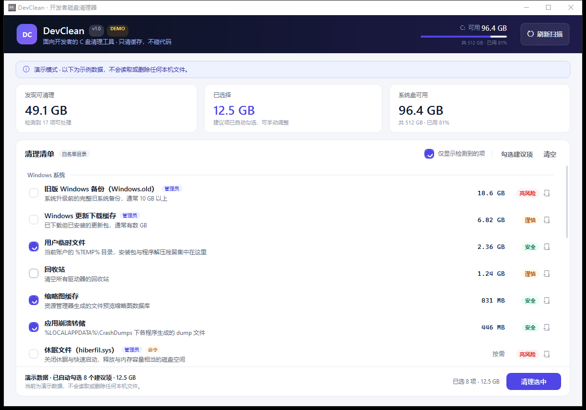
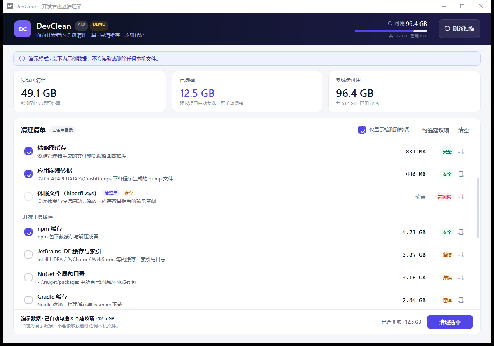
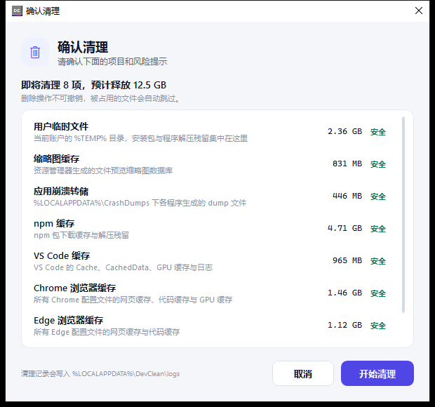

# DevClean

官网: [https://suboy1219.github.io/suboy](https://suboy1219.github.io/suboy)

English | [简体中文](README.md)

A Windows disk cleanup tool built for developers. It scans system caches and developer
toolchain caches, groups them by size and risk, and only deletes the items you select.
Everything is based on a built-in allowlist: personal files and source code are never touched.

> Screenshots in this document are generated with the built-in demo mode
> (`DevClean.exe --demo`). They use fictional disk capacity and cache sizes and contain
> no usernames, real free-space values, or local cache data.

## Run It

Download `DevClean.exe` from [GitHub Releases](https://github.com/suboy1219/DevClean/releases/latest) and run it on Windows x64.

A portable single-file build is available at:

```
publish\DevClean.exe
```

No .NET installation is required. The first scan usually takes 15-30 seconds.

To preview the UI without reading or deleting anything on this machine:

```powershell
.\publish\DevClean.exe --demo
```

## Screenshots

### Main window



### Developer caches



### Cleanup confirmation



*The v1.0 UI is Chinese. English localization is planned for a later release.*

## Features

- Scans cleanable locations and shows real sizes, risk level, and admin requirements
- Groups items into `Windows`, `Developer caches`, `Browsers & apps`, and `Other`
- Automatically selects `Safe` recommended items after each scan; adjust manually as needed
- Risk levels: Safe / Caution / High risk; high-risk items stay unchecked and require
  an extra acknowledgement in the confirmation dialog
- One-click relaunch as administrator for Windows Update, WinSxS, hibernation, and other
  system-level items
- Per-item results, skip reasons, and total space reclaimed after cleaning
- Local logs at `%LOCALAPPDATA%\DevClean\logs`
- Headless CLI for automation and verification

## Coverage

**Windows**

User/system temp, Windows Update download cache, Delivery Optimization, error reporting,
crash dumps, Prefetch, Windows logs, Windows.old, upgrade leftovers, Recycle Bin,
thumbnail cache, WinSxS, hibernation file.

**Developer toolchains**

npm / Yarn / pnpm / pip / NuGet / Gradle / Maven / Cargo / rustup / Go / Dart Pub /
JetBrains / VS Code / Visual Studio / ASP.NET temporary files / Electron /
Docker prune / Unity / Unreal / Android emulator snapshots / ccache.

**Browsers and apps**

Chrome / Edge / Brave / Firefox / WebView2 / Office / Microsoft Store / NVIDIA.

> `pagefile.sys` and the Downloads folder are report-only and never deleted automatically.
> Docker appears only when `docker.exe` is available and runs `docker system prune`;
> it does not delete the WSL virtual disk.

## Safety

- Every target is a fixed allowlist path; there is no “scan the whole profile and delete”
  behavior
- Refuses drive roots, Windows, Program Files, the user profile root, AppData roots,
  Desktop, Documents, and Downloads
- Does not follow junctions or symlinks during recursive deletion
- Clears the read-only flag when needed; locked files are skipped and reported, never forced
- Shows full paths, sizes, and risk levels before deletion; high-risk items require
  explicit acknowledgement
- Writes a local log for every cleanup session

## Build

Requires the .NET 10 SDK with the Windows Desktop runtime.

```powershell
dotnet build -c Release
dotnet run -c Release
```

Portable single-file build (self-contained runtime, ~60 MB):

```powershell
.\build.ps1 -SelfContained
```

Smaller framework-dependent build (requires .NET 10 Desktop Runtime on the target machine):

```powershell
.\build.ps1
```

## CLI

```powershell
DevClean.exe                     # GUI
DevClean.exe --demo              # Demo data, no local file access
DevClean.exe --scan              # Scan and print a report
DevClean.exe --scan --json       # JSON output
DevClean.exe --scan --out report.txt
DevClean.exe --clean-safe --yes  # Delete all "Safe" items (destructive)
DevClean.exe --selftest          # Self-test the deletion engine
DevClean.exe --help
```

## Known Limitations

- The v1.0 UI is Chinese only; English UI is on the roadmap
- The executable is not code-signed, so SmartScreen may warn on first launch
- Files in use by browsers, IDEs, or Docker are skipped
- Windows Update, WinSxS, Windows.old, and hibernation require administrator rights
- Registry cleanup, startup management, and driver cleanup are intentionally out of scope

## Roadmap

Process-in-use detection and close prompts, WSL / Docker virtual disk compaction,
large-file finder, scheduled scan reminders, English UI, and an installer.

## Project Layout

```
Models/            Cleanup item and enum models
Services/          Catalog, demo data, path resolution, size scanner, cleaner, elevation, CLI
ViewModels/        Main window view model
Views/             Confirmation dialog
Themes/            UI styles
MainWindow.xaml    Main window
docs/              README screenshots (demo data)
```

## Check for updates

Choose **Help → Check for updates** (帮助 → 检测更新) in the window. The app compares its version with the latest stable GitHub release and offers to open the release page when an update is available. It also reports missing releases and connection errors.
