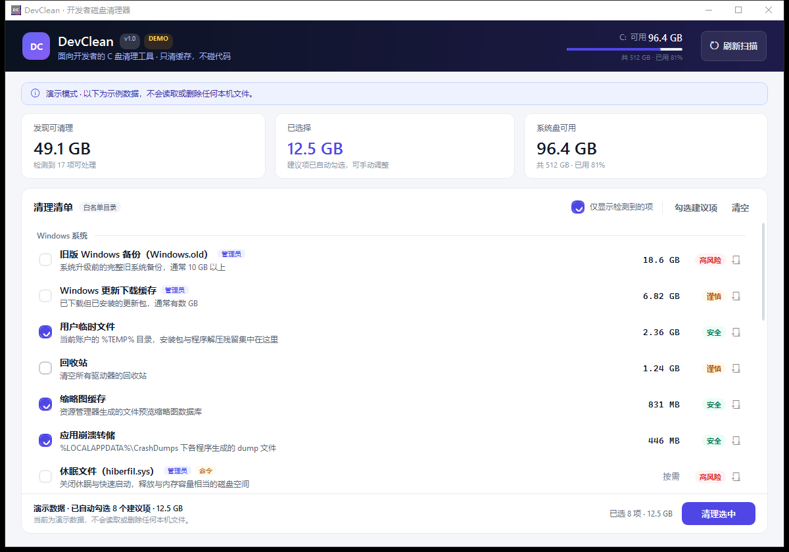
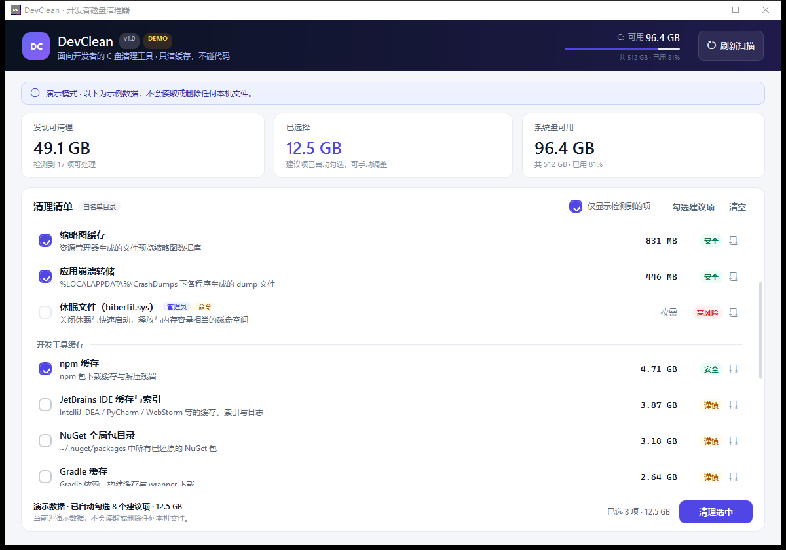
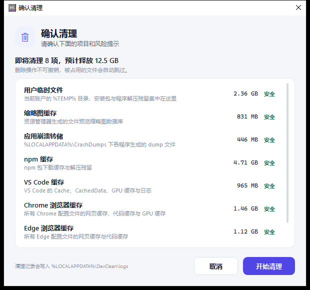

# DevClean

官网: [https://suboy1219.github.io/suboy](https://suboy1219.github.io/suboy)

[English](README.en.md) | 简体中文

面向开发者的 Windows C 盘清理工具。扫描系统和开发工具链的缓存目录，按大小与风险列出，
勾选后清理。只处理内置白名单，不触碰个人文档与代码。

> 本文截图由内置演示模式（`DevClean.exe --demo`）生成，使用虚构的磁盘容量与缓存数据，
> 不包含用户名、真实可用空间或本机缓存信息。

## 直接运行

从 [GitHub Releases](https://github.com/suboy1219/DevClean/releases/latest) 下载 `DevClean.exe`，双击运行（Windows x64）。

免安装单文件版本：

```
publish\DevClean.exe
```

双击即可运行，不需要安装 .NET。首次启动会自动扫描，通常 15-30 秒。

只想先看界面效果，可以用演示模式，不会读取或删除任何本机文件：

```powershell
.\publish\DevClean.exe --demo
```

## 效果图

### 主界面



### 开发工具缓存



### 清理确认



## 功能

- 扫描 C 盘可清理项，显示实际占用大小、风险等级和是否需要管理员权限
- 按 `Windows 系统` / `开发工具缓存` / `浏览器与常用应用` / `其他与排查` 分组
- 扫描完成后自动勾选“安全”级别的建议清理项，可手动取消
- 风险分级：安全 / 谨慎 / 高风险；高风险项默认不勾选，确认弹窗里还需额外确认
- 支持以管理员身份重启，处理 Windows Update、WinSxS、休眠文件等系统项
- 清理后显示逐项结果、失败原因和累计释放空间
- 日志写入 `%LOCALAPPDATA%\DevClean\logs`
- 提供命令行模式，便于自动化、CI 和验证

## 覆盖范围（部分）

**Windows 系统**

用户/系统临时文件、Windows 更新下载缓存、传递优化、错误报告、崩溃转储、Prefetch、
Windows 日志、Windows.old、升级残留、回收站、缩略图、WinSxS、休眠文件。

**开发工具**

npm / Yarn / pnpm / pip / NuGet / Gradle / Maven / Cargo / rustup / Go /
Dart Pub / JetBrains / VS Code / Visual Studio / ASP.NET 临时文件 / Electron /
Docker prune / Unity / Unreal / Android 模拟器快照 / ccache。

**浏览器与常用应用**

Chrome / Edge / Brave / Firefox / WebView2 / Office / Microsoft Store / NVIDIA。

> 虚拟内存文件（pagefile.sys）和下载文件夹只统计大小，不会自动删除。
> Docker 只有在检测到 `docker.exe` 时才会显示，执行的是 `docker system prune`，
> 不会直接删除 WSL 虚拟磁盘。

## 安全设计

- 每个清理项都是固定白名单路径，不做“扫描整个用户目录再删除”的模糊操作
- 拒绝磁盘根目录、Windows、Program Files、用户主目录、AppData 根、桌面、文档、下载等目标
- 递归删除时不跟随 junction / 符号链接，只删除链接本身
- 只读文件先清除只读位，正在被占用的文件跳过并统计，不强行结束进程
- 删除前展示完整路径、大小和风险等级，高风险项需要二次确认
- 每次清理写入本地日志，可追溯清理了哪些目录

## 构建

需要 .NET 10 SDK（含 Windows Desktop 运行时）。

```powershell
dotnet build -c Release
dotnet run -c Release
```

发布为免安装单文件 exe（自包含运行时，约 60 MB）：

```powershell
.\build.ps1 -SelfContained
```

目标机器已安装 .NET 10 Desktop Runtime 时，可发布更小的依赖版：

```powershell
.\build.ps1
```

## 命令行

```powershell
DevClean.exe                     # 图形界面
DevClean.exe --demo              # 演示模式，使用示例数据
DevClean.exe --scan              # 扫描并输出报告
DevClean.exe --scan --json       # JSON 输出
DevClean.exe --scan --out report.txt
DevClean.exe --clean-safe --yes  # 自动清理“安全”级项目，会真实删除
DevClean.exe --selftest          # 删除逻辑自检
DevClean.exe --help
```

## 已知限制

- v1.0 界面为中文，英文界面在后续版本中补充
- 程序未做代码签名，首次运行可能出现 SmartScreen 提示
- 浏览器、IDE、Docker 等程序运行时，部分文件会被占用并自动跳过
- Windows Update、WinSxS、Windows.old、休眠文件等需要管理员权限
- 暂不包含注册表清理、启动项管理、驱动清理

## 后续方向

进程占用检测与一键关闭提示、WSL / Docker 虚拟磁盘压缩、大文件排查、
定时扫描提醒、英文界面与安装包。

## 目录结构

```
Models/            清理项与枚举模型
Services/          清单、演示数据、路径解析、大小扫描、清理器、提权、命令行
ViewModels/        主界面视图模型
Views/             清理确认弹窗
Themes/            界面样式
MainWindow.xaml    主界面
docs/              README 截图（演示数据）
```

## 检测更新

在窗口中选择 **帮助 → 检测更新**。程序会比较当前版本和本项目 GitHub 最新正式发布版；发现新版后可选择打开发布页下载。无正式发布版或网络失败时会显示提示。
